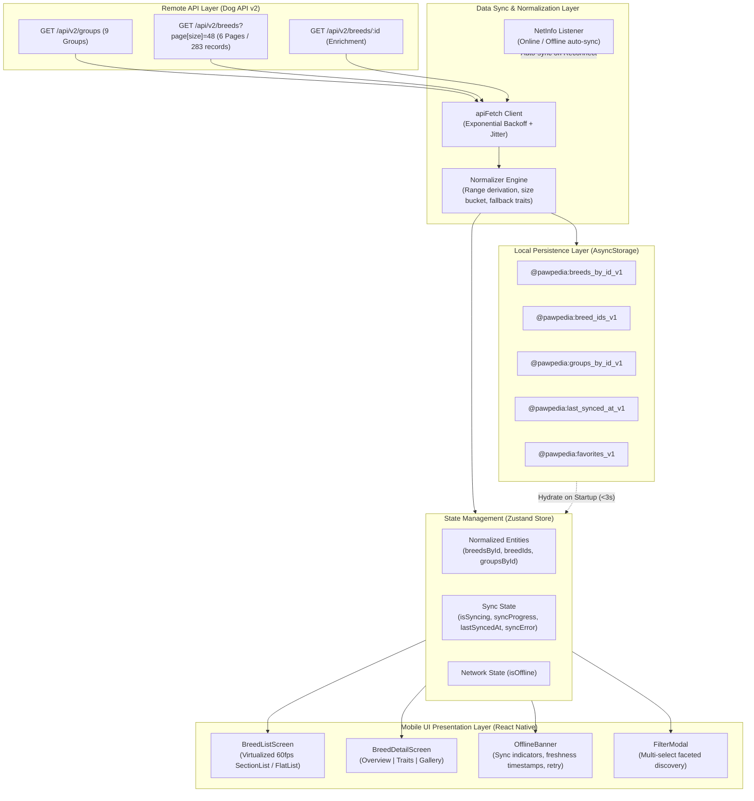

# System Architecture — Pawpedia Dog Breed Explorer

Pawpedia is an offline-first, production-grade React Native mobile application built with TypeScript, Expo SDK 58, Zustand, and AsyncStorage. It allows dog enthusiasts to explore 283 dog breeds, filter by multiple criteria (breed group, size classification, coat length, hypoallergenic, and 11 visual trait scales), and view enriched breed details and galleries even under unreliable or absent network conditions.

---

## 1. High-Level Architecture & Data Flow

---

## 2. Core Architectural Pillars

### A. Offline-First Strategy
1. **Instant Hydration (<3s Interactive)**:
   - On app launch, `hydrateFromStorage()` immediately restores the normalized entities from `AsyncStorage`. Users can browse the entire 283-breed catalog instantly without waiting for network requests.
2. **Background Sync Engine**:
   - When the device is online, the sync engine fetches all 9 breed groups and merges the 6 paginated pages (48 items/page) into a coherent dataset.
   - If the network goes offline during or before a sync, the app continues to operate on cached records.
   - An active NetInfo event listener automatically triggers a non-disruptive background sync as soon as network connectivity is restored.
3. **Partial Failure Resilience**:
   - If a sync attempt fails mid-way, existing cached data is preserved untouched.
   - A descriptive error banner is presented with a one-tap "Retry" button.
4. **Data Freshness Indicators**:
   - Freshness timestamps ("Last synced just now", "Last synced 2 hours ago", "Last synced yesterday") are prominently displayed at the top of the interface.

---

### B. Normalized Cache Design
Rather than storing raw API JSON or deeply nested arrays, entities are normalized into relational hash maps:
- `breedsById`: `Record<string, Breed>` (O(1) lookups for detail navigation and single-item updates)
- `breedIds`: `string[]` (Stable order index for virtualized rendering)
- `groupsById`: `Record<string, BreedGroup>` (Normalized relations between groups and breeds)
- `favorites`: `string[]` (Locally persisted bookmarks)

#### Benefits:
- Eliminates duplicate records.
- Single-breed enrichment (`GET /api/v2/breeds/:id`) updates only the modified record in O(1) time without triggering re-renders of unrelated list rows.

---

### C. Multi-Tier Image Caching & Memory Budgeting
Each breed in Dog API v2 carries up to 9 images, each with `thumb`, `medium`, and `large` variants and rich CC/Wikimedia attribution.

| Tier | Variant | Typical Size | Decoding Buffer | Used In |
|---|---|---|---|---|
| **Tier 1 (Thumbnail)** | `thumb` | 15–25 KB | ~120 KB | List Screen Virtualized Cards (60fps target) |
| **Tier 2 (Hero/Preview)** | `medium` | 80–140 KB | ~1.2 MB | Detail Screen Hero & Gallery Strip |
| **Tier 3 (High-Res)** | `large` | 250–500 KB | ~4.5 MB | Fullscreen Pinch-to-Zoom Lightbox |

- **Upgrade Lifecycle**:
  - Scrolling through the list exclusively requests `thumb` variants.
  - Tapping a breed pre-fetches the first 5 `medium` variants.
  - Tapping a photo inside the Gallery opens the `large` variant in a lightbox modal.
- **Memory Footprint**:
  - Restricts heap usage to `<150MB` under normal use by leveraging disk caching and clearing decoded bitmap buffers on low-memory events.

---

### D. Virtualized List Rendering (60fps Target)
- High-frequency virtualized scrolling across 283 heavy records (nested traits, coat, origin, and image arrays) is achieved through:
  1. `React.memo` with custom comparator checking `breed.id` and `breed.updatedAt`.
  2. Fixed item height layout calculation (`getItemLayout`) eliminating dynamic layout measurements.
  3. Window tuning: `initialNumToRender={10}`, `maxToRenderPerBatch={10}`, `windowSize={5}`, `removeClippedSubviews={true}`.
  4. Toggleable presentation: Grouped by breed group (`SectionList`) or flat alphabetical view (`FlatList`).
